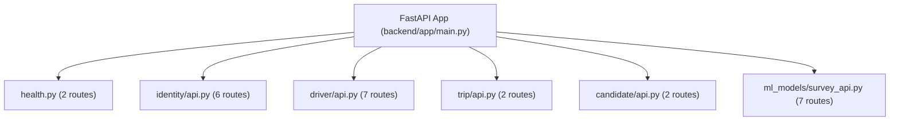

# BẢNG KIỂM KÊ MÃ NGUỒN CHUẨN TẮC TOÀN HỆ THỐNG
## (P3_CANONICAL_SOURCE_INVENTORY_FINAL)

- **Dự án:** Ride_Sharing
- **Commit HEAD xác thực:** `f97a5092ece737d70051d08e6e3604e6a0c6bd1d`
- **Parent SHA xác thực:** `d9a2a324d7a887ceaeff52a82b8a45bcad6d0ea9`
- **Tree SHA xác thực:** `2126a22d634e455e28bddf47d0d5fbf699fcc640`
- **Tổng số file Git theo dõi:** 463 files
- **Trạng thái tài liệu:** Chuẩn tắc (Thống nhất và thay thế hoàn toàn `P3_CANONICAL_SOURCE_INVENTORY.md` cũ)

---

## 1. Cấu Trúc Gói Ứng Dụng & Danh Mục 12 Module Nghiệp Vụ Thực Tế

Toàn bộ mã nguồn ứng dụng backend được tổ chức tại `backend/app/` theo mô hình **Modular Monolith**:
- `backend/app/core/`: Hạ tầng dùng chung (cấu hình `settings.py`, logging, ngoại lệ toàn cục `errors.py`).
- `backend/app/db/`: Quản lý kết nối cơ sở dữ liệu (`database.py`, Base ORM `base.py`, định nghĩa enum types `types.py`).
- `backend/app/api/`: Router kiểm tra sức khỏe hệ thống (`health.py`).
- `backend/app/modules/`: **Đúng 12 modules nghiệp vụ** (đã được kiểm tra trực tiếp từ cấu trúc thư mục trên đĩa):

| STT | Tên Thư Mục Module | Trách nhiệm Nghiệp Vụ Cốt Lõi | Các File Chính |
|---|---|---|---|
| 1 | `booking` | Vòng đời đặt chỗ (Schema Phase 1, Service read views Phase 2/3, Lifecycle Phase 4) | `models.py`, `service.py` |
| 2 | `candidate` | Sinh và đánh giá ứng viên ghép xe (P2), tích hợp cổng định giá P3 | `models.py`, `service.py`, `generator.py`, `evaluator.py`, `api.py` |
| 3 | `driver` | Quản lý hồ sơ tài xế, phương tiện, KYC, tọa độ vị trí thực thời | `models.py`, `service.py`, `api.py` |
| 4 | `fund` | Sổ cái Quỹ bảo đảm (`fund_ledger`), chi trả tài xế (`driver_payouts`) | `models.py`, `service.py` |
| 5 | `identity` | Xác thực người dùng, JWT refresh tokens, quản lý phân quyền và giới tính | `models.py`, `service.py`, `api.py` |
| 6 | `intercity` | Chuyến đi liên tỉnh theo lịch, đặt ghế chuyến liên tỉnh (Phase 1 schema, Phase 5 logic) | `models.py` |
| 7 | `jobs` | Quản lý tác vụ chạy nền có lịch trình (`scheduled_jobs`) | `models.py` |
| 8 | `ml_models` | Khảo sát nghiên cứu người dùng S1, mô hình phân tích dữ liệu | `models.py`, `survey_api.py` |
| 9 | `pooling` | Thuật toán chèn điểm dừng, biểu diễn kế hoạch ghép, trạng thái giá chèn | `models.py`, `insertion.py`, `pricing_state.py`, `repository.py` |
| 10 | `pricing` | Toàn bộ engine định giá Phase 3: Biểu cước, Số học phân số, Ghép xe hai phía, Phí hủy, Tất toán | `params.py`, `money.py`, `tariff.py`, `pool.py`, `cancellation.py`, `settlement.py`, `pool_check.py` |
| 11 | `routing` | Tích hợp OSRM, tính ma trận khoảng cách/thời gian, điểm đón trả | `models.py`, `client.py`, `service.py` |
| 12 | `trip` | Yêu cầu chuyến đi (`trip_requests`), quản lý khu vực dịch vụ (`service_areas`) | `models.py`, `service.py`, `api.py` |

---

## 2. Danh Mục 26 HTTP REST API Endpoints Thực Tế

Toàn bộ các routes được đăng ký vào FastAPI application thông qua `backend/app/main.py`:



| STT | Phương thức | Endpoint Path | Function Handler | Nguồn File Router |
|---|---|---|---|---|
| 1 | `GET` | `/health/live` | `live` | `backend/app/api/health.py` |
| 2 | `GET` | `/health/ready` | `ready` | `backend/app/api/health.py` |
| 3 | `POST` | `/api/auth/register` | `register` | `backend/app/modules/identity/api.py` |
| 4 | `POST` | `/api/auth/login` | `login` | `backend/app/modules/identity/api.py` |
| 5 | `POST` | `/api/auth/refresh` | `refresh` | `backend/app/modules/identity/api.py` |
| 6 | `POST` | `/api/auth/logout` | `logout` | `backend/app/modules/identity/api.py` |
| 7 | `GET` | `/api/users/me` | `me` | `backend/app/modules/identity/api.py` |
| 8 | `PUT` | `/api/users/me/gender` | `set_gender` | `backend/app/modules/identity/api.py` |
| 9 | `GET` | `/api/driver/profile` | `get_profile` | `backend/app/modules/driver/api.py` |
| 10 | `POST` | `/api/driver/vehicles` | `add_vehicle` | `backend/app/modules/driver/api.py` |
| 11 | `POST` | `/api/driver/kyc/submit` | `submit_kyc` | `backend/app/modules/driver/api.py` |
| 12 | `PUT` | `/api/driver/settings` | `update_settings` | `backend/app/modules/driver/api.py` |
| 13 | `PUT` | `/api/driver/location` | `update_location` | `backend/app/modules/driver/api.py` |
| 14 | `PUT` | `/api/driver/availability` | `update_availability` | `backend/app/modules/driver/api.py` |
| 15 | `POST` | `/api/admin/drivers/{driver_id}/kyc-review` | `kyc_review` | `backend/app/modules/driver/api.py` |
| 16 | `POST` | `/api/trip-requests` | `create_trip_request` | `backend/app/modules/trip/api.py` |
| 17 | `GET` | `/api/trip-requests/{trip_id}` | `get_trip_request` | `backend/app/modules/trip/api.py` |
| 18 | `POST` | `/api/admin/candidates/runs` | `create_run` | `backend/app/modules/candidate/api.py` |
| 19 | `GET` | `/api/admin/candidates/runs/{run_id}` | `get_run` | `backend/app/modules/candidate/api.py` |
| 20 | `GET` | `/survey/s1` | `form` | `backend/app/modules/ml_models/survey_api.py` |
| 21 | `POST` | `/api/survey/s1/sessions` | `start` | `backend/app/modules/ml_models/survey_api.py` |
| 22 | `POST` | `/api/survey/s1/sessions/{respondent_id}/submit` | `submit` | `backend/app/modules/ml_models/survey_api.py` |
| 23 | `GET` | `/api/admin/survey/s1/export/{table}` | `export` | `backend/app/modules/ml_models/survey_api.py` |
| 24 | `GET` | `/api/admin/survey/s1/quota` | `quota` | `backend/app/modules/ml_models/survey_api.py` |
| 25 | `GET` | `/api/admin/survey/s1/rejections` | `rejections` | `backend/app/modules/ml_models/survey_api.py` |
| 26 | `DELETE`| `/api/admin/survey/s1/respondents/{respondent_id}`| `delete_respondent` | `backend/app/modules/ml_models/survey_api.py` |

> *Ghi chú quan trọng:* Các module `pricing`, `fund`, `pooling` ở Phase 3 đóng vai trò là domain services lõi (được gọi nội bộ bởi Candidate Generator và Settlement), **chưa mở public REST endpoints** trong `main.py`. Mọi báo cáo trước đây liệt kê các route như `/pricing/quote` hay `/fund/balance` đều là suy diễn không có thật.

---

## 3. Danh Mục 6 Alembic Database Migrations Thực Tế

Toàn bộ lịch sử tiến hóa cơ sở dữ liệu được quản lý trong `backend/alembic/versions/`:

| STT | File Migration | Revision ID | Down Revision | Nội Dung Schema & Thay Đổi Kỹ Thuật Thực Tế |
|---|---|---|---|---|
| 1 | `0001_p1_core_schema.py` | `0001` | `None` | **Khởi tạo 15 bảng cốt lõi:** `pricing_configs`, `scheduled_jobs`, `users`, `driver_profiles`, `idempotency_records`, `refresh_tokens`, `seat_holds`, `vehicles`, `ride_plans`, `scheduled_trips`, `bookings`, `ride_candidates`, `driver_payouts`, `fund_ledger`, `ride_participants`. Thiết lập 2 triggers bảo vệ `pricing_configs`. |
| 2 | `0002_p1_survey_s1_draft_storage.py` | `0002` | `0001` | **Khởi tạo 2 bảng khảo sát:** `survey_respondents`, `survey_responses`. |
| 3 | `0003_p1_service_area_excluded_layer.py` | `0003` | `0002` | Hỗ trợ vùng hình học `EXCLUDED` cho khu vực dịch vụ (GEO-03 / GEO-04). |
| 4 | `0004_p1_survey_s1_duration.py` | `0004` | `0003` | Thêm cột `duration_seconds` vào bảng khảo sát để gắn cờ QC2. |
| 5 | `0005_p2_routing_candidate_pooling.py` | `0005` | `0004` | **Khởi tạo bảng:** `candidate_runs` phục vụ lưu trữ kết quả benchmark Phase 2. |
| 6 | `0006_p3_pricing_fund.py` | `0006` | `0005` | **Bổ sung kỹ thuật Phase 3:** Thêm cột `pricing_version`, `plan_fare_exact` vào `ride_plans`; `fare_exact_rational` vào `ride_participants`; `pricing_version` vào `bookings`; các ràng buộc CHECK tài chính và **4 Triggers** bảo vệ bất biến Quỹ và Lịch trình. |

---

## 4. Danh Mục 24 Bảng Ứng Dụng (ORM Models)

Khớp nối chính xác giữa các class trong `backend/app/modules/*/models.py` và tên bảng cơ sở dữ liệu:

1. `bookings` (`booking/models.py`) — *Đã tạo từ 0001; cập nhật 0006.*
2. `seat_holds` (`booking/models.py`) — *Đã tạo từ 0001.*
3. `idempotency_records` (`booking/models.py`) — *Đã tạo từ 0001.*
4. `candidate_runs` (`candidate/models.py`) — *Đã tạo từ 0005.*
5. `ride_candidates` (`candidate/models.py`) — *Đã tạo từ 0001.*
6. `driver_profiles` (`driver/models.py`) — *Đã tạo từ 0001.*
7. `vehicles` (`driver/models.py`) — *Đã tạo từ 0001.*
8. `driver_locations` (`driver/models.py`) — *Bảng phụ trợ lưu vị trí tài xế.*
9. `driver_payouts` (`fund/models.py`) — *Đã tạo từ 0001; cập nhật 0006.*
10. `fund_ledger` (`fund/models.py`) — *Đã tạo từ 0001; cập nhật 0006.*
11. `users` (`identity/models.py`) — *Đã tạo từ 0001.*
12. `refresh_tokens` (`identity/models.py`) — *Đã tạo từ 0001.*
13. `scheduled_trips` (`intercity/models.py`) — *Đã tạo từ 0001.*
14. `seat_bookings` (`intercity/models.py`) — *Mô hình đặt ghế liên tỉnh.*
15. `scheduled_jobs` (`jobs/models.py`) — *Đã tạo từ 0001.*
16. `survey_respondents` (`ml_models/models.py`) — *Đã tạo từ 0002.*
17. `survey_responses` (`ml_models/models.py`) — *Đã tạo từ 0002; cập nhật 0004.*
18. `ride_plans` (`pooling/models.py`) — *Đã tạo từ 0001; cập nhật 0006.*
19. `ride_participants` (`pooling/models.py`) — *Đã tạo từ 0001; cập nhật 0006.*
20. `ride_stops` (`pooling/models.py`) — *Mô hình điểm dừng chặng ghép.*
21. `pricing_configs` (`pricing/models.py`) — *Đã tạo từ 0001.*
22. `pickup_points` (`routing/models.py`) — *Mô hình điểm đón định sẵn.*
23. `trip_requests` (`trip/models.py`) — *Mô hình yêu cầu chuyến.*
24. `service_areas` (`trip/models.py`) — *Mô hình ranh giới địa lý dịch vụ.*

---

## 5. Danh Mục Trigger Functions & Trigger Instances Toàn Hệ Thống

Toàn bộ hệ thống có **chính xác 5 Trigger Functions và 6 Trigger Instances**:

```text
Database Triggers Architecture:
├── Migration 0001:
│   └── Function: pricing_configs_immutable()
│       ├── Instance 1: trg_pricing_configs_immutable (BEFORE UPDATE OR DELETE ON pricing_configs)
│       └── Instance 2: trg_pricing_configs_no_truncate (BEFORE TRUNCATE ON pricing_configs)
└── Migration 0006:
    ├── Function: fund_ledger_guard()
    │   └── Instance 3: trg_fund_ledger_guard (BEFORE INSERT OR UPDATE OR DELETE ON fund_ledger)
    │       * Đặc biệt: Cho phép duy nhất UPDATE onchain_tx_hash (Phase 9 audit).
    ├── Function: driver_payouts_immutable()
    │   └── Instance 4: trg_driver_payouts_immutable (BEFORE UPDATE OR DELETE ON driver_payouts)
    ├── Function: ride_participants_frozen_guard()
    │   └── Instance 5: trg_ride_participants_frozen (BEFORE UPDATE ON ride_participants)
    └── Function: bookings_locked_pool_price_guard()
        └── Instance 6: trg_bookings_locked_pool_price (BEFORE UPDATE ON bookings)
```

### Chi tiết hành vi của `trg_fund_ledger_guard`:
1. **Khi INSERT:** Thực thi `PERFORM pg_advisory_xact_lock(hashtext('fund_ledger_chain'))` để khóa tuần tự chuỗi giao dịch. Kiểm tra nghiêm ngặt `balance_after_vnd = previous_balance + amount_signed_vnd`. Ném ngoại lệ vi phạm nếu sai lệch dù chỉ 1 đồng.
2. **Khi UPDATE:**
   ```sql
   IF OLD.onchain_tx_hash IS NULL AND NEW.onchain_tx_hash IS NOT NULL
      AND (to_jsonb(NEW) - 'onchain_tx_hash') = (to_jsonb(OLD) - 'onchain_tx_hash') THEN
       RETURN NEW;  -- Cho phép Phase 9 ghi nhận giao dịch kiểm toán Blockchain
   END IF;
   RAISE EXCEPTION 'fund_ledger is append-only (G12); correct with a new entry';
   ```
3. **Khi DELETE:** Nghiêm cấm tuyệt đối.

### Các Ràng Buộc CHECK Tài Chính Bất Biến trong Migration 0006:
- `ck_fund_ledger_ledger_balance_non_negative`: `balance_after_vnd >= 0` (Nghiêm cấm tuyệt đối số dư âm trong sổ cái).
- `ck_driver_payouts_amounts_non_negative`: Toàn bộ các cấu phần chi trả tài xế không được âm.
- `ck_driver_payouts_total_consistent`: `total_payout_vnd = base_payout_vnd + guarantee_payout_vnd`.
- `ck_driver_payouts_gross_consistent`: `gross_fare_vnd = base_payout_vnd + platform_fee_vnd + guarantee_fee_vnd`.

