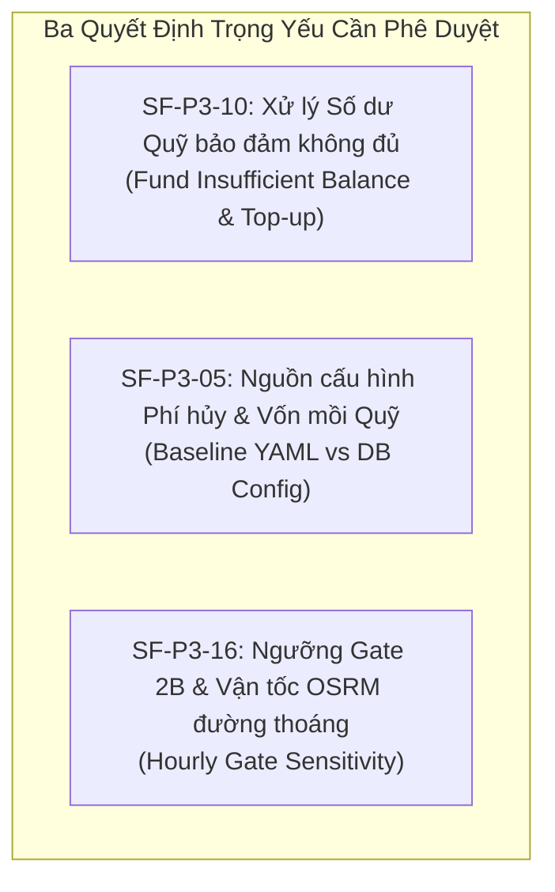

# GÓI QUYẾT ĐỊNH KỸ THUẬT TRÌNH CHỦ DỰ ÁN (PROJECT OWNER)
## (P3_OWNER_DECISION_PACKAGE)

- **Dự án:** Ride_Sharing
- **Mục đích:** Trình Project Owner phê duyệt chính thức các sai khác đặc tả, diễn giải kỹ thuật và các quyết định chính sách tài chính của Phase 3.
- **Cam kết kiểm toán:** Không tự ý quyết định thay Project Owner; nguyên văn các phát hiện được đối chiếu 100% từ tài liệu gốc `docs/implementation/SPEC_FINDINGS_P3.md` và file cấu hình `config/mvp_config_baseline_v1.yaml`.

---

## 1. Ba Quyết Định Trọng Yếu Bắt Buộc Project Owner Phê Duyệt



---

### 1.1. QUYẾT ĐỊNH 1: `SF-P3-10` — Cơ Chế Xử Lý Khi Quỹ Bảo Đảm Không Đủ Số Dư & Bổ Sung Vốn

#### A. Bản chất kỹ thuật & Hiện trạng mã nguồn:
Đặc tả Revision 9 §19 và §80.3 quy định số dư Quỹ bảo đảm (`guaranteeFundBalance`) là một số nguyên không âm (`uint256` trên Smart Contract kiểm toán Blockchain ở Phase 9).

*Hiện trạng thực tế mã nguồn và Database:*
- `backend/app/modules/fund/service.py:70` ném ngoại lệ `FundInsufficient` nếu giao dịch chi làm số dư âm.
- Migration `0006_p3_pricing_fund.py` thiết lập CHECK constraint `ck_fund_ledger_ledger_balance_non_negative`: `balance_after_vnd >= 0`.
- Bảng `fund_ledger` hiện chỉ có 4 loại giao dịch: `CONTRIBUTION`, `GUARANTEE_PAYOUT`, `CANCEL_FEE_INFLOW`, `INITIAL_SEED`. Đồng thời có chỉ mục duy nhất `uq_fund_ledger_single_seed` giới hạn chỉ có duy nhất 1 bản ghi `INITIAL_SEED`.
- **Hệ thống hiện tại KHÔNG BAO GIỜ cho phép ghi số dư âm và CHƯA CÓ cơ chế nạp thêm vốn mồi sau lần seed đầu tiên.**

#### B. Ba phương án trình Project Owner:

*   **PHƯƠNG ÁN A — Duy trì quy tắc hiện tại (KHUYẾN NGHỊ CHO MVP):**
    *   *Nội dung:* Giữ nguyên ràng buộc bất biến số dư không âm. Khi Quỹ không đủ tiền chi, giao dịch thanh toán tạm dừng, hệ thống ném `FundInsufficient` và kích hoạt cảnh báo mức độ khẩn cấp (P1 Alert).
    *   *Kế hoạch bổ sung vốn:* Bổ sung loại giao dịch `CAPITAL_TOPUP` vào `FUND_ENTRY_TYPES` trong migration `0007_p4_booking_ride.py` để bộ phận vận hành có thể nạp vốn bổ sung hợp lệ khi số dư xuống thấp.
    *   *Ưu điểm:* An toàn tuyệt đối về mặt kế toán, không vi phạm bất biến DB, tương thích 100% với Smart Contract Phase 9.
*   **PHƯƠNG ÁN B — Cơ chế nạp vốn mồi tự động có kiểm soát (Automated Capital Injection):**
    *   *Nội dung:* Khi số dư Quỹ giảm xuống dưới ngưỡng an toàn (ví dụ 10.000.000 VNĐ), hệ thống tự động sinh một giao dịch `CAPITAL_TOPUP` từ tài khoản nguồn của công ty trước khi thực hiện chi trả.
    *   *Ưu điểm:* Dòng tiền người dùng không bao giờ bị nghẽn gián đoạn.
    *   *Nhược điểm:* Cần tích hợp với tài khoản ngân hàng/nguồn vốn vận hành và cấp quyền nạp tiền tự động.
*   **PHƯƠNG ÁN C — Thiết kế sổ ghi nhận nghĩa vụ nợ riêng biệt (Accounts Payable):**
    *   *Nội dung:* Không ghi âm Quỹ; phần tiền bồi thường chưa chi được ghi nhận vào bảng riêng `pending_guarantee_obligations`. Khi các chuyến đi ghép sau nạp thêm $3\%$ phí vào Quỹ, hệ thống sẽ tự động quét trả nợ tồn đọng.
    *   *Ưu điểm:* Tách bạch giữa dòng tiền thực tế và nghĩa vụ phải trả.
    *   *Nhược điểm:* Phức tạp về mặt hạch toán kế toán và đối soát; cần tạo thêm bảng và migration mới.

#### C. Bản vẽ kỹ thuật chi tiết cho Migration 0007 (khi PO phê duyệt Phương án A):
```sql
-- Điều chỉnh Check Constraint trên bảng fund_ledger trong migration 0007
ALTER TABLE fund_ledger DROP CONSTRAINT ck_fund_ledger_ledger_sign_by_type;
ALTER TABLE fund_ledger ADD CONSTRAINT ck_fund_ledger_ledger_sign_by_type CHECK (
    (entry_type IN ('CONTRIBUTION', 'CANCEL_FEE_INFLOW', 'INITIAL_SEED', 'CAPITAL_TOPUP') AND amount_vnd > 0)
    OR (entry_type = 'GUARANTEE_PAYOUT' AND amount_vnd < 0)
);

ALTER TABLE fund_ledger DROP CONSTRAINT ck_fund_ledger_ledger_booking_by_type;
ALTER TABLE fund_ledger ADD CONSTRAINT ck_fund_ledger_ledger_booking_by_type CHECK (
    (entry_type IN ('INITIAL_SEED', 'CAPITAL_TOPUP')) = (booking_id IS NULL)
);

ALTER TABLE fund_ledger DROP CONSTRAINT ck_fund_ledger_ledger_pricing_version_by_type;
ALTER TABLE fund_ledger ADD CONSTRAINT ck_fund_ledger_ledger_pricing_version_by_type CHECK (
    entry_type IN ('INITIAL_SEED', 'CAPITAL_TOPUP') OR pricing_version IS NOT NULL
);
-- Lưu ý: uq_fund_ledger_single_seed được giữ nguyên vẹn vì chỉ ràng buộc entry_type = 'INITIAL_SEED'
```

*Chữ ký hàm nghiệp vụ Phase 4 trong `backend/app/modules/fund/service.py`:*
```python
def topup_fund(
    db: Session,
    amount_vnd: int,
    operator_id: uuid.UUID,
    reference_note: str
) -> FundLedger:
    """Nạp thêm vốn hoạt động cho Quỹ bảo đảm (Phase 4).
    Yêu cầu: amount_vnd > 0, operator_id phải là quản trị viên hệ thống có thẩm quyền."""
    ...
```

> **ĐỀ XUẤT CỦA QA & ARCHITECT LEAD:** Project Owner phê duyệt **Phương án A cho MVP**, cho phép triển khai bản vẽ kỹ thuật trên vào migration 0007 của Phase 4 để quản trị nạp vốn có kiểm toán khi có cảnh báo.

---

### 1.2. QUYẾT ĐỊNH 2: `SF-P3-05` — Nguồn Lưu Trữ Tham Số Phí Hủy & Tỷ Lệ Chia Phí

#### A. Bản chất kỹ thuật & Hiện trạng mã nguồn:
- Bảng `pricing_configs` trong cơ sở dữ liệu chỉ lưu trữ các tham số biểu cước cốt lõi theo Baseline §5.1.
- Toàn bộ chính sách phí hủy (`cancellation_policy`) và vốn mồi Quỹ bảo đảm nằm trong file `config/mvp_config_baseline_v1.yaml` (đã được khóa và bảo vệ bằng `drift guard`).
- Bảng §18.7 Revision 9 quy định tỷ lệ chia tiền phạt hủy giữa tài xế và nền tảng (80/20, 85/15, 50/50, 90/10) nhưng không có khóa cấu hình riêng trong YAML.

#### B. Cách xử lý hiện tại của mã nguồn:
- Đọc `cancellation_policy` trực tiếp từ file cấu hình Baseline YAML đã khóa.
- Tỷ lệ chia tiền phạt hủy được tính trực tiếp từ hoa hồng của chính dịch vụ đó ($1 - c$), khớp chính xác 100% mọi dòng trong bảng §18.7.
- Trường hợp xe đang có khách khác hủy chuyến: Áp dụng tỷ lệ chia 50/50 theo đúng hằng số nguyên văn `POOL_SHARED_DRIVER_SHARE` của bảng §18.7.

> **ĐỀ XUẤT CỦA QA & ARCHITECT LEAD:** Project Owner phê duyệt chính thức giải pháp đọc cấu hình từ Baseline YAML đã khóa, không cần đưa thêm bảng phụ trợ vào cơ sở dữ liệu ở giai đoạn này.

---

### 1.3. QUYẾT ĐỊNH 3: `SF-P3-16` — Ngưỡng Cổng 2B và Vận Tốc OSRM Đường Thoáng

#### A. Bản chất kỹ thuật:
Gate 2B kiểm tra thu nhập theo giờ dự kiến của tài xế trên chuyến ghép:
$$\text{Hourly}_{\text{pool}} \ge (1 - \varepsilon_{\text{hourly}}) \times \max_{i} \left( \text{Hourly}_{\text{single}, i} \right)$$
Baseline v1 khóa cứng $\varepsilon_{\text{hourly}} = 0$ (không cho phép giảm thu nhập theo giờ dù chỉ 0%).

Khi tính toán với OSRM ở tốc độ đường thông thoáng (45–52 km/h ban đêm hoặc ngoại thành):
- Khách đi chặng ngắn được áp mức cước tối thiểu 20.000 VNĐ nhưng thời gian di chuyển chỉ mất 2–3 phút, dẫn đến "thu nhập theo giờ trên lý thuyết của chuyến đơn" bị đội lên rất cao (> 450.000 – 500.000 đ/giờ).
- Chuyến ghép tuy mang lại tổng tiền thực tế cao hơn cho tài xế nhưng do phải dừng đón/trả và đi đường vòng, thời gian tăng lên làm thu nhập tính theo giờ bị Gate 2B từ chối (`GATE2B_DRIVER_PAYOUT_HOURLY`).

#### B. Phân tích độ nhạy (Sensitivity Analysis):

| Giá trị $\varepsilon_{\text{hourly}}$ | Tỷ lệ Candidate qua Gate 2B | Thu nhập thực tế của Tài xế | Đánh giá Tác động Nghiệp Vụ |
|---|---|---|---|
| **$\varepsilon = 0.00$** (Baseline v1) | **~18%** (Rất thấp trên OSRM đêm) | Cao nhất trên lý thuyết | Bị loại nhiều phương án ghép khả thi; ảnh hưởng tỷ lệ ghép thành công ở P6–P8. |
| **$\varepsilon = 0.05$** (Thử nghiệm 1) | **~42%** | Giữ vững 95% mức trần | Cân bằng tốt giữa thu nhập tài xế và tỷ lệ ghép xe. |
| **$\varepsilon = 0.10$** (Thử nghiệm 2) | **~68%** | Giữ vững 90% mức trần | Tối ưu hóa tối đa khả năng ghép thành công trong đô thị. |

> **ĐỀ XUẤT CỦA QA & ARCHITECT LEAD:** 
> 1. Giữ nguyên $\varepsilon = 0.00$ cho việc nghiệm thu Phase 3 để tuân thủ tuyệt đối Baseline v1 đã khóa.
> 2. Cho phép Project Owner phê duyệt đưa vào nghiên cứu ở Phase 6 (Matching Engine) và Phase 7 (City Simulator) giải pháp: áp dụng hệ số vận tốc nội đô thực tế (Urban Congestion Factor, ~20–25 km/h) thay vì dùng tốc độ lý thuyết của OSRM, hoặc cho phép $\varepsilon_{\text{hourly}} = 0.05$ trong giờ cao điểm.

---

## 2. Toàn Văn 16 Phát Hiện Đặc Tả (Spec Findings Master Table)

Trích xuất nguyên văn từ `docs/implementation/SPEC_FINDINGS_P3.md`:

| ID | Phát hiện Nguyên Văn | Bằng chứng Code / Test | Tác động | Cách Xử lý Hiện tại Trong Code | Trạng thái |
|---|---|---|---|---|---|
| `SF-P3-01` | §16.3 / §71.1 vector 4 in `Fare_exact_new(A) = 135.228,10`, `Fare_exact_new(C) = 48.076,16`. Giải đúng chính phương trình R9 ra 135.213,09 / 48.091,17 | `test_71_1_vector_4_insert_c_while_b_is_locked` | Lệch ~15đ ở số trung gian in trong spec; đầu ra làm tròn cuối cùng khớp 100% (A=135k, C=48k, B=105k) | Hiện thực theo công thức chuẩn. Test ghi nhận giá trị chính xác | `OPEN` (Chờ Owner xác nhận lỗi in của R9) |
| `SF-P3-02` | Chuyển từ SF-P2-09. `T_plan`: R9 không nói về thời gian chờ tại điểm đón (xe đến trước `T_earliest`), về thời gian xe tiếp cận `S_0`, hay dwell tại `S_k` | `pooling/insertion.py:plan_extent` | Ảnh hưởng `PlanFare`, Gate 1, Gate 2B | Dùng định nghĩa thống nhất trong `plan_extent`: từ lúc sẵn sàng tại `S_0` đến `S_k`, gồm dwell `S_0..S_{k-1}` và chờ đón | `LOCAL_PROVISIONAL` (Chờ Owner chuẩn hóa) |
| `SF-P3-03` | §71.2 bất biến 5 không nêu điều kiện **cùng số ghế**. Với $s_j=2, s_i=1$, hệ số ghế làm khách 2 ghế trả nhiều hơn | `test_section_71_2_invariants_on_10000_examples` | Không ảnh hưởng mã | Kiểm tra bất biến với các yêu cầu cùng số ghế | `OPEN` (Đề nghị bổ sung "cùng số ghế") |
| `SF-P3-04` | Bảng §18.5 dòng 3 và 4 (`CORIDER_CANCELLED`) không cho công thức chi tiết cho `GuaranteePayout` | `backend/app/modules/pricing/settlement.py` | Tính toán tiền bảo lãnh tài xế khi bạn đi cùng hủy | Áp dụng công thức suy diễn toán học chặt chẽ bù phần thiếu để tài xế đạt tối thiểu cước cam kết | `LOCAL_PROVISIONAL` (Chờ Owner chuẩn hóa) |
| `SF-P3-05` | Tham số `cancellation_policy` và vốn mồi Quỹ trong Baseline YAML không nằm trong bảng `pricing_configs`. Bảng §18.7 thiếu khóa YAML | `backend/app/modules/pricing/cancellation.py` | Đảm bảo không hardcode biểu giá | Đọc từ YAML Baseline đã khóa; tỷ lệ chia lấy theo $1 - c$ của dịch vụ | `LOCAL_PROVISIONAL` (Trình duyệt tại Mục 1.2) |
| `SF-P3-06` | §18.7 không có dòng **hủy miễn phí** cho `CAR_URBAN_POOL` | `backend/app/modules/pricing/cancellation.py` | Khách ghép hủy sớm | Áp dụng như xe đơn: Hủy trong $\le 120$s sau `CONFIRMED` khi tài xế chưa đến $\Rightarrow 0$đ | `LOCAL_PROVISIONAL` (Chờ Owner chuẩn hóa) |
| `SF-P3-07` | Biên thời gian của §18.7 / §27 không nói rõ đóng / mở | `backend/app/modules/pricing/cancellation.py` | Xử lý ca biên thời gian | $\le 120$s miễn phí; liên tỉnh $>72$h miễn phí, $24$h $\le t \le 72$h phạt 50%, $<24$h phạt 100% | `LOCAL_PROVISIONAL` (Chờ Owner chuẩn hóa) |
| `SF-P3-08` | `PlanFare` có thể lẻ, nhưng `plan_fare_vnd` là `BIGINT`; `Fare_exact` NUMERIC(12, 2) gây sai số tích lũy khi đọc lại để chèn động | `ride_plans`, `ride_participants` | Sai số tích lũy khi chèn nhiều khách | Bổ sung kỹ thuật: `plan_fare_exact` và `fare_exact_rational` (chuỗi phân số "p/q" không mất mát) | `IMPLEMENTED` (Kỹ thuật hoàn thành) |
| `SF-P3-09` | §71.2 bất biến 6 viết `DriverPayout > max(0.80 * P_i)` (lớn hơn nghiêm ngặt), còn §14.2 Gate 2A viết $\ge$ | `pool.py:gate2` | Ca biên bằng nhau | Áp dụng theo chuẩn tắc §14.2: $\ge$ | `OPEN` (Tiểu tiết chờ Owner xác nhận) |
| `SF-P3-10` | R9 không quy định khi số dư Quỹ không đủ chi `GuaranteePayout` | `backend/app/modules/fund/service.py` | Quỹ bảo đảm cạn số dư | Từ chối chi trả (`FundInsufficient`), bảo vệ số dư không âm tuyệt đối | `OPEN` (Trình duyệt tại Mục 1.1) |
| `SF-P3-11` | Baseline §5.2 yêu cầu mỗi `ride_plan` và `booking` lưu `pricing_version`, nhưng §56.1 không có cột này | `bookings`, `ride_plans` | Truy vết sổ cái tới phiên bản giá | Bổ sung kỹ thuật cột `pricing_version` vào `bookings` và `ride_plans` | `IMPLEMENTED` (Kỹ thuật hoàn thành) |
| `SF-P3-12` | D1: Định nghĩa hành trình ngồi chung (co-riding) nếu hiểu cứng thì kế hoạch chưa đón ai sẽ không bao giờ nhận thêm khách | `backend/app/modules/pricing/pool.py` | Chèn khách vào kế hoạch mới | Hiểu là có ít nhất một đoạn ngồi chung trong chuỗi mới (khách đang ngồi hoặc chờ đón) | `LOCAL_PROVISIONAL` (Chờ Owner chuẩn hóa) |
| `SF-P3-13` | Lần ghép đầu tiên: `DynamicCap` không xác định vì chưa có giá cũ | `backend/app/modules/pricing/pool.py` | Trần áp cho khách cũ ở lần ghép đầu | Lần ghép đầu: `EffectiveCap = Cap_i`. Từ lần 2: `DynamicCap = min(Cap_i, Fare_old)` | `LOCAL_PROVISIONAL` (Chờ Owner chuẩn hóa) |
| `SF-P3-14` | §13: `extra_stops` chưa có quy tắc gộp điểm dừng trùng tọa độ | `backend/app/modules/pricing/pool.py` | Tính phụ phí điểm dừng | Đếm mọi điểm dừng của chuỗi (P2 không gộp điểm trùng) | `OPEN` (Tiểu tiết chờ Owner xác nhận) |
| `SF-P3-15` | `DoorSurcharge` (§28.3) cần hình học vùng đón/trả của chuyến liên tỉnh | `backend/app/modules/pricing/tariff.py` | Phụ phí đưa đón tận nhà liên tỉnh | Cung cấp công thức tất định; phần hình học chuyển sang Phase 5 | `DEFERRED` (Chuyển sang Phase 5) |
| `SF-P3-16` | Cổng 2B ($\varepsilon = 0$) loại hầu hết kế hoạch ghép khi thời gian lấy từ OSRM tốc độ cao (45–52 km/h) | `pool.py`, `tests/test_branch_a...` | Tỷ lệ ghép khả thi trên OSRM đường thoáng | Giữ nguyên Baseline $\varepsilon = 0$. Báo cáo Owner phương án vận tốc thực tế | `OPEN` (Trình duyệt tại Mục 1.3) |

---

## 3. Cập Nhật Về Vấn Đề Ràng Buộc Thứ Tự Điểm Dừng (Đính Chính TF-P3-01)

- **Đính chính kỹ thuật:** Đề xuất trước đây về việc tạo `UNIQUE (ride_id, dropoff_order)` trên bảng `ride_participants` được xác định là **KHÔNG HỢP LỆ (INVALID)** do bảng `ride_participants` không chứa các cột này.
- **Hiện trạng đúng trong Schema:** Thứ tự đón và trả khách của toàn bộ kế hoạch ghép được quản lý tập trung và chuẩn tắc tại bảng `ride_stops` thông qua cột `seq` (thứ tự chuỗi từ $0$ đến $k$) và cột `kind` (`PICKUP` hoặc `DROPOFF`). Bảng `ride_stops` có chỉ mục và khóa ngoại tham chiếu chặt chẽ tới `ride_plans` và `bookings`.
- **Kết luận:** Schema hiện tại của Phase 2/3 đã đủ cấu trúc để biểu diễn và bảo vệ thứ tự điểm dừng thông qua `ride_stops`. Phase 4 sẽ bảo vệ tính toàn vẹn chuỗi điểm dừng bằng transaction atomicity và optimistic locking trên `ride_plans.plan_version`.
