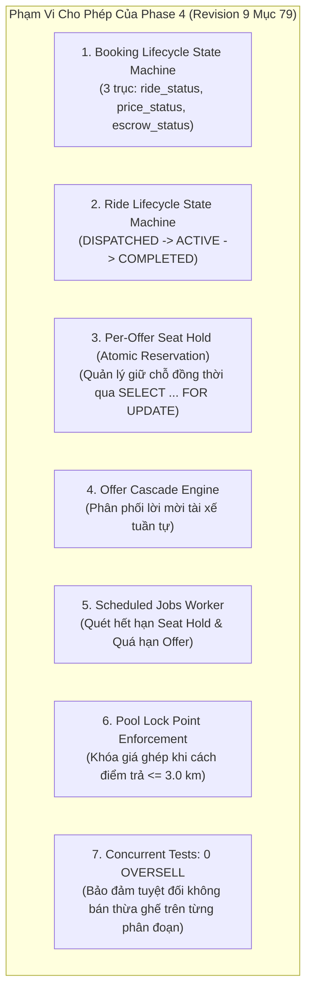

# DANH MỤC BÀN GIAO VÀ ĐIỀU KIỆN TIÊN QUYẾT CHO PHASE 4
## (P3_PHASE4_HANDOFF_CHECKLIST)

- **Dự án:** Ride_Sharing
- **Mục đích:** Xác lập ranh giới kỹ thuật chính xác, phân loại tài sản kế thừa từ Phase 0–3, liệt kê các thành phần cần triển khai mới và các bất biến bắt buộc phải bảo vệ trong Phase 4.
- **Tiêu chuẩn quy định:** Đặc tả Revision 9 — Mục 73 và 79 (Kế hoạch phát triển Phase 4).

---

## 1. Ranh Giới Kỹ Thuật Bất Biến Của Phase 4



### Các Hạng Mục Tuyệt Đối Không Triển Khai Trong Phase 4:
1. **KHÔNG** triển khai luồng ghép xe liên tỉnh (Intercity Pooling — Thuộc Phase 5).
2. **KHÔNG** triển khai Matching đa tiêu chí nâng cao / Recommendation (Thuộc Phase 6).
3. **KHÔNG** triển khai Trình giả lập tải quy mô đô thị (City Simulator — Thuộc Phase 7).
4. **KHÔNG** tích hợp Trí tuệ nhân tạo / Dynamic Pricing Machine Learning (Thuộc Phase 8).
5. **KHÔNG** triển khai Blockchain Smart Contract Audit Ledger (Thuộc Phase 9).
6. **KHÔNG** xây dựng Engine khớp lệnh hàng loạt theo lô CP-SAT (Thuộc Phase 10).
7. **KHÔNG** phát triển giao diện Web hoặc Mobile App (Frontend) trong giai đoạn này.

---

## 2. Phân Loại Tài Sản Mã Nguồn & Cơ Sở Dữ Liệu Thực Tế

| Nhóm Tài Sản | Tên Thành Phần | Vị Trí Hiện Hữu | Trạng Thái Hiện Tại | Phân Tích & Nhiệm Vụ Trong Phase 4 |
|---|---|---|---|---|
| **EXISTING_SCHEMA** | `bookings` | `booking/models.py`, `0001`, `0006` | ĐÃ CÓ (15 cột, 3 trục trạng thái D-46, trigger khóa giá `0006`) | **Kế thừa**. Không tạo lại bảng; sử dụng trực tiếp cho máy trạng thái Booking. |
| **EXISTING_SCHEMA** | `seat_holds` | `booking/models.py`, `0001:128` | **SKELETON TỐI THIỂU** (Chỉ có `id`, `request_id`, `status`, `expires_at`, `created_at`) | **Cần mở rộng:** Hiện chưa có `driver_id`, `ride_plan_id`, `seat_count`, `offer_id`. Cần ALTER TABLE hoặc liên kết với `driver_offers`. |
| **EXISTING_SCHEMA** | `idempotency_records` | `booking/models.py`, `0001:156` | ĐÃ CÓ (`UNIQUE (user_id, idempotency_key)`) | **Kế thừa**. Sử dụng cho header `Idempotency-Key` của API đặt chỗ. |
| **EXISTING_SCHEMA** | `scheduled_jobs` | `jobs/models.py`, `0001:61` | ĐÃ CÓ (Bảng lưu trạng thái cron jobs) | **Kế thừa**. Phục vụ worker quét hết hạn giữ chỗ và offer. |
| **EXISTING_SCHEMA** | `ride_plans` | `pooling/models.py`, `0001`, `0006` | ĐÃ CÓ (`plan_version`, `pricing_version`, `plan_fare_exact`) | **Kế thừa**. Quản lý vòng đời chuyến đi và kế hoạch ghép. |
| **EXISTING_SCHEMA** | `ride_participants` | `pooling/models.py`, `0001`, `0006` | ĐÃ CÓ (Bảo vệ giá bằng trigger `0006`) | **Kế thừa**. Lưu ý: Bảng này **không có cột `ride_id` hay `dropoff_order`**; thứ tự điểm dừng được quản lý ở `ride_stops`. |
| **EXISTING_SCHEMA** | `ride_stops` | `pooling/models.py:78` | ĐÃ CÓ (`ride_plan_id`, `seq`, `kind`, `booking_id`, `geom`) | **Kế thừa**. Thứ tự đón/trả được xác định qua `seq` và `kind` ('PICKUP' / 'DROPOFF'). |
| **EXISTING_SERVICE** | Module `pricing` | `backend/app/modules/pricing/` | HOÀN THÀNH 100% | **Kế thừa**. Cung cấp hàm định giá, báo giá, khóa giá, tính phí hủy và tất toán. |
| **EXISTING_SERVICE** | Module `fund` | `backend/app/modules/fund/` | HOÀN THÀNH 100% (4 entry types) | **Cần mở rộng schema:** Hiện mới hỗ trợ `INITIAL_SEED`, chưa có `TOPUP` cho việc nạp bổ sung vốn mồi khi vận hành. |
| **PARTIAL_IMPLEMENTATION** | `booking/service.py` | `backend/app/modules/booking/` | MỚI CÓ 43 DÒNG | **Cần viết mới toàn diện:** Xây dựng máy trạng thái 3 trục của Booking và các API giao dịch. |
| **MISSING_IMPLEMENTATION** | Worker nền `jobs` | `backend/app/modules/jobs/` | CHƯA CÓ SERVICE | **Cần viết mới:** Xây dựng `jobs/service.py` để quét hết hạn giữ chỗ và hết hạn lời mời offer. |
| **NEW_SCHEMA_REQUIRED** | Bảng `driver_offers` | Database Schema P4 | CHƯA CÓ | **Cần tạo migration 0007:** Lưu danh sách lời mời gửi tới tài xế trong cơ chế Offer Cascade. |

---

## 3. Bản Thiết Kế Migration Phase 4 Chuẩn Tắc (`0007_p4_booking_ride.py`)

Các điểm hiệu chỉnh kỹ thuật sống còn:
1.  **Khóa ngoại của `driver_id`:** Bảng `driver_profiles` có khóa chính là `user_id` (không có cột `id`). Do đó, `driver_offers.driver_id` phải tham chiếu tới `driver_profiles.user_id` hoặc `users.id`.
2.  **Hủy bỏ đề xuất sai TF-P3-01:** Bảng `ride_participants` không có cột `ride_id` hay `dropoff_order`. Thứ tự đón trả được quản lý tập trung tại `ride_stops.seq`. Không tạo constraint sai lệch trên `ride_participants`.
3.  **Bổ sung loại giao dịch Quỹ (`TOPUP`):** Thêm `TOPUP` vào enum `FUND_ENTRY_TYPES` để cho phép nạp thêm vốn mồi khi vận hành.
4.  **Mở rộng `seat_holds`:** Bổ sung cột `seat_count`, `ride_plan_id`, `driver_id` để hỗ trợ Per-Offer Seat Hold nguyên tử.

```python
"""p4 booking lifecycle, driver offers and seat hold additions

Revision ID: 0007
Revises: 0006
Create Date: 2026-11-15 00:00:00
"""
from alembic import op
import sqlalchemy as sa
from sqlalchemy.dialects.postgresql import UUID

def upgrade() -> None:
    # 1. Tạo bảng driver_offers phục vụ cơ chế Offer Cascade
    op.create_table(
        'driver_offers',
        sa.Column('id', UUID(as_uuid=True), primary_key=True, server_default=sa.text('gen_random_uuid()')),
        sa.Column('booking_id', UUID(as_uuid=True), sa.ForeignKey('bookings.id'), nullable=False),
        # KHÓA NGOẠI CHÍNH XÁC: driver_profiles.user_id (không phải driver_profiles.id)
        sa.Column('driver_id', UUID(as_uuid=True), sa.ForeignKey('driver_profiles.user_id'), nullable=False),
        sa.Column('ride_plan_id', UUID(as_uuid=True), sa.ForeignKey('ride_plans.id'), nullable=True),
        sa.Column('sequence_order', sa.Integer(), nullable=False),
        sa.Column('status', sa.String(20), nullable=False, server_default='PENDING'),
        sa.Column('expires_at', sa.DateTime(timezone=True), nullable=False),
        sa.Column('created_at', sa.DateTime(timezone=True), server_default=sa.text('now()'), nullable=False),
        sa.CheckConstraint("status IN ('PENDING', 'ACCEPTED', 'REJECTED', 'EXPIRED')", name='ck_driver_offers_status')
    )
    op.create_index('idx_driver_offers_driver_status', 'driver_offers', ['driver_id', 'status', 'expires_at'])

    # 2. Mở rộng seat_holds phục vụ Per-Offer Seat Hold
    op.add_column('seat_holds', sa.Column('seat_count', sa.Integer(), nullable=False, server_default='1'))
    op.add_column('seat_holds', sa.Column('ride_plan_id', UUID(as_uuid=True), sa.ForeignKey('ride_plans.id'), nullable=True))
    op.add_column('seat_holds', sa.Column('driver_id', UUID(as_uuid=True), sa.ForeignKey('driver_profiles.user_id'), nullable=True))
    op.add_column('seat_holds', sa.Column('offer_id', UUID(as_uuid=True), sa.ForeignKey('driver_offers.id'), nullable=True))

    # 3. Cập nhật CHECK constraints cho fund_ledger để cho phép nạp vốn bổ sung (CAPITAL_TOPUP)
    op.drop_constraint('ck_fund_ledger_ledger_sign_by_type', 'fund_ledger', type_='check')
    op.create_check_constraint(
        'ck_fund_ledger_ledger_sign_by_type',
        'fund_ledger',
        "(entry_type IN ('CONTRIBUTION', 'CANCEL_FEE_INFLOW', 'INITIAL_SEED', 'CAPITAL_TOPUP') AND amount_vnd > 0) OR (entry_type = 'GUARANTEE_PAYOUT' AND amount_vnd < 0)"
    )

    op.drop_constraint('ck_fund_ledger_ledger_booking_by_type', 'fund_ledger', type_='check')
    op.create_check_constraint(
        'ck_fund_ledger_ledger_booking_by_type',
        'fund_ledger',
        "(entry_type IN ('INITIAL_SEED', 'CAPITAL_TOPUP')) = (booking_id IS NULL)"
    )

    op.drop_constraint('ck_fund_ledger_ledger_pricing_version_by_type', 'fund_ledger', type_='check')
    op.create_check_constraint(
        'ck_fund_ledger_ledger_pricing_version_by_type',
        'fund_ledger',
        "entry_type IN ('INITIAL_SEED', 'CAPITAL_TOPUP') OR pricing_version IS NOT NULL"
    )

def downgrade() -> None:
    op.drop_constraint('ck_fund_ledger_ledger_pricing_version_by_type', 'fund_ledger', type_='check')
    op.create_check_constraint(
        'ck_fund_ledger_ledger_pricing_version_by_type',
        'fund_ledger',
        "entry_type = 'INITIAL_SEED' OR pricing_version IS NOT NULL"
    )

    op.drop_constraint('ck_fund_ledger_ledger_booking_by_type', 'fund_ledger', type_='check')
    op.create_check_constraint(
        'ck_fund_ledger_ledger_booking_by_type',
        'fund_ledger',
        "(entry_type = 'INITIAL_SEED') = (booking_id IS NULL)"
    )

    op.drop_constraint('ck_fund_ledger_ledger_sign_by_type', 'fund_ledger', type_='check')
    op.create_check_constraint(
        'ck_fund_ledger_ledger_sign_by_type',
        'fund_ledger',
        "(entry_type IN ('CONTRIBUTION', 'CANCEL_FEE_INFLOW', 'INITIAL_SEED') AND amount_vnd > 0) OR (entry_type = 'GUARANTEE_PAYOUT' AND amount_vnd < 0)"
    )
    op.drop_column('seat_holds', 'offer_id')
    op.drop_column('seat_holds', 'driver_id')
    op.drop_column('seat_holds', 'ride_plan_id')
    op.drop_column('seat_holds', 'seat_count')
    op.drop_table('driver_offers')
```

---

## 4. Đặc Tả Ba Trục Trạng Thái Booking (Orthogonal State Machine — D-46)

Trong [backend/app/modules/booking/models.py:32-63](file:///C:/RideSharing/backend/app/modules/booking/models.py#L32-L63), bảng `bookings` có chính xác 3 trục trạng thái độc lập:

```text
Trục 1: ride_status (Tiến trình vật lý của chuyến đi)
HELD -> CONFIRMED -> RIDE_STARTED -> COMPLETED
  |          |               |
  |          +---------------+---> CANCELLED_BY_PASSENGER / CANCELLED_BY_DRIVER / CANCELLED_BY_SYSTEM
  |                          |
  +---> EXPIRED              +---> NO_SHOW

Trục 2: price_status (Trạng thái cam kết giá)
QUOTED -> POOL_SEARCHING -> MATCHED_LOCKED / UNMATCHED_LOCKED
   |
   +----> FIXED_LOCKED (Đối với xe đơn / chuyến không ghép)
   |
   +----> MERGED_REDUCED_LOCKED / TOPUP_LOCKED (Liên tỉnh Phase 5)

Trục 3: escrow_status (Trạng thái dòng tiền ký quỹ)
NONE -> DEPOSIT_PENDING -> DEPOSITED -> LOCKED -> RELEASED (Tất toán thành công)
                               |           |
                               |           +----> TOPPED_UP (Nạp thêm cước)
                               |
                               +----------------> REFUNDED (Hoàn tiền hủy chuyến)
                               |
                               +----------------> DISPUTED -> RESOLVED
```

---

## 5. Bốn Bất Biến Sống Còn Phải Bảo Vệ Trong Phase 4

### 1. Bất biến 0 Oversell (Zero Overselling on Segments):
- **Nguyên tắc:** Tại bất kỳ phân đoạn nào giữa hai điểm dừng liên tiếp $S_j \rightarrow S_{j+1}$ của chuyến xe, tổng số ghế đang chở cộng số ghế đã giữ chỗ (`seat_holds` ở trạng thái `ACTIVE`) **tuyệt đối không được vượt quá sức chứa phương tiện (`vehicle.capacity`)**.
- **Cơ chế khóa:** Sử dụng câu lệnh khóa bi quan `SELECT ... FOR UPDATE` trên hàng `ride_plans` khi xử lý chấp nhận lời mời (Offer Accept), kết hợp với kiểm tra `plan_version` để ngăn ngừa race condition. (Không lạm dụng `SKIP LOCKED` cho tài nguyên ghế vì có thể bỏ qua xung đột dẫn đến bán trùng ghế).

### 2. Bất biến Khóa Giá Điểm 3 km (`Pool Lock Point`):
- **Vị trí kích hoạt:** Khi xe di chuyển còn cách **ĐIỂM TRẢ KHÁCH (DROP-OFF POINT) $\le 3.0\text{ km}$** (`pool_lock_remaining_km = 3.0` theo Baseline YAML).
- **Hành vi:** Kích hoạt một lần duy nhất hàm `final_price_at_lock()`, ghi giá chốt vào `final_price_vnd`, chuyển `price_status` sang `MATCHED_LOCKED` hoặc `UNMATCHED_LOCKED`. Trigger `trg_bookings_locked_pool_price` trong DB sẽ ngăn chặn mọi hành vi sửa đổi giá sau thời điểm này.

### 3. Bước Recheck Tuyến Đường OSRM `/route` Trước Khi Gửi Offer:
- **Bằng chứng từ Phase 3:** Kiểm tra 17.640 ứng viên ghép xe phát hiện **204 ứng viên (1.16%)** bị vi phạm HC03/HC05 khi đối soát giữa OSRM `/table` và `/route`.
- **Yêu cầu Phase 4:** Bộ điều phối (Dispatcher) trước khi tạo `seat_holds` và gửi lời mời qua Offer Cascade **bắt buộc phải gọi OSRM `/route` để kiểm tra lại chuỗi điểm dừng thực tế**, lọc bỏ 1.16% ứng viên không đạt chuẩn trước khi phân phối tới tài xế.

### 4. Bất biến Idempotency Tuyệt Đối:
- Mọi request đặt chỗ hoặc giữ chỗ mang header `Idempotency-Key` khi gửi lặp lại bởi cùng một người dùng (`user_id`) phải trả về cùng một mã booking và kết quả xử lý, không bao giờ sinh booking kép.
